[](LICENSE)
[](https://www.w3.org/standards/semanticweb/)
[](https://www.w3.org/TR/skos-reference/)
[](https://iiif.io/)

# مطالعهٔ موردی معماری ایران | Iranian Architecture Case Study

## فارسی

### دربارهٔ پروژه

این مخزن، فضای همکاری آموزشی و پژوهشی دانشجویان معماری دانشگاه اصفهان برای سازمان‌دهی و پیوند دادن منابع دیجیتال معماری ایران است. چهار پروژهٔ مستقل در چهار حوزهٔ زیر پیش می‌روند؛ هر پروژه موضوع، داده‌ها و مواد پژوهشی خود را دارد و از واژگان و هستی‌شناسی مشترک مخزن استفاده می‌کند.

هدف، طراحی راهکارهایی مبتنی بر هستی‌شناسی، دادهٔ پیوندی (Linked Data) و OWL برای توصیف، کشف و پیوندپذیر کردن منابع معماری است. تجمیع منابع دیجیتال در لایهٔ بالادستی بر پایهٔ IIIF انجام می‌شود.

### چهار حوزهٔ پژوهش

۱. **تدوین چارچوب مفهومی، تحلیل و طبقه‌بندی اصطلاحات مرتبط با معماری ایران با هدف سازمان‌دهی منابع دیجیتال**
   - تدوین اصطلاح‌نامهٔ کوچک و چندزبانهٔ معماری ایران و تعیین روابط مفهومی.
   - فایل آغازین: [`common/thesaurus.ttl`](common/thesaurus.ttl)

۲. **تدوین الگوی توصیف و فرادادهٔ اسناد دیجیتال معماری ایران**
   - طراحی الگوی توصیف منابع و اسناد دیجیتال و مستندسازی عناصر فراداده.

۳. **شناسایی و تحلیل منابع دیجیتال معماری ایران در مجموعه‌های GLAM**
   - شناسایی و تحلیل منابع در گالری‌ها، کتابخانه‌ها، آرشیوها و موزه‌ها (GLAM) و بررسی امکان استفادهٔ مجدد و پیونددهی آن‌ها.

۴. **تدوین الگوی پیوند و بازنمایی منابع معماری ایران مبتنی بر IIIF؛ نمونهٔ موردی: مسجد جامع اصفهان**
   - طراحی الگوی بازنمایی و پیوند منابع مبتنی بر IIIF، با مسجد جامع اصفهان به‌عنوان نمونهٔ موردی.

### ساختار مفهومی مشترک

```text
.
├── common/
│   ├── thesaurus.ttl       # واژگان مفهومی SKOS معماری ایران
│   └── ontology/           # هستی‌شناسی مشترک (در حال تدوین)
├── projects/
│   ├── project-01/          # چارچوب مفهومی و اصطلاحات
│   ├── project-02/          # توصیف و فراداده
│   ├── project-03/          # منابع دیجیتال GLAM
│   └── project-04/          # بازنمایی IIIF؛ مسجد جامع اصفهان
└── README.md
```

پوشه‌های پروژه‌ها می‌توانند با آغاز کار گروه‌ها ایجاد و نام‌گذاری شوند. داده‌ها و مواد اختصاصی هر گروه در پوشهٔ همان پروژه نگهداری می‌شود؛ واژگان، الگوها و هستی‌شناسی‌های مورد استفادهٔ مشترک در `common/` قرار می‌گیرند.

### اصطلاح‌نامهٔ مشترک

اصطلاح‌نامهٔ اولیه در [`common/thesaurus.ttl`](common/thesaurus.ttl) به Turtle و با الگوی SKOS ارائه شده است. ساختار آغازین آن پنج رده دارد:

1. **تکنیک**
2. **متریال و مصالح**
3. **کاربرد**
4. **المان‌ها و اجزاء**
5. **سبک و دوره**

هر مفهوم می‌تواند برچسب فارسی و انگلیسی، اصطلاحات جایگزین، یادداشت دامنه و روابط سلسله‌مراتبی داشته باشد. برای سلسله‌مراتب، در فایل Turtle فقط `skos:broader` را روی مفهوم خاص‌تر ثبت می‌کنیم؛ `skos:narrower` رابطهٔ معکوس آن است و لازم نیست هر دو جهت را تکرار کنیم. دو نگاشت نمونهٔ بررسی‌شده به ویکی‌داده با `skos:exactMatch` در فایل آمده‌اند. این رابطه را فقط وقتی به کار ببرید که دو مفهوم واقعاً هم‌معنا باشند؛ برای تطبیق تقریبی از `skos:closeMatch` استفاده کنید. پیوند به AAT نیز پس از بررسی شناسه و مفهوم متناظر افزوده می‌شود. TGN عمدتاً واژگان جغرافیایی است؛ بنابراین پیوند به آن باید برای مکان‌ها و موجودیت‌های جغرافیاییِ پروژه‌ها باشد، نه به‌عنوان تطبیق مستقیم اصطلاحات معماری. شناسهٔ خارجی را حدس نزنید.

نمودار زیر نمایش ساده‌شدهٔ ساختار اصطلاح‌نامه است. پیکان‌ها از مفهوم عام به خاص‌اند؛ در Turtle، رابطهٔ `skos:broader` از مفهوم خاص به عام ثبت می‌شود.

```mermaid
graph TD
    root["واژگان معماری ایران | Iranian Architecture"]
    root --> technique["تکنیک | Technique"]
    root --> materials["متریال و مصالح | Materials"]
    root --> use["کاربرد | Use"]
    root --> elements["المان‌ها و اجزاء | Elements and components"]
    root --> styles["سبک و دوره | Styles and periods"]

    technique --> techniques["فنون ساخت | Construction techniques"]
    techniques --> bricklaying["آجرکاری | Bricklaying"]
    techniques --> tilework["کاشی‌کاری | Tilework"]
    techniques --> vault_construction["اجرای طاق | Vault construction"]
    techniques --> dome_construction["اجرای گنبد | Dome construction"]
    techniques --> muqarnas_construction["اجرای مقرنس | Muqarnas construction"]

    materials --> building_materials["مصالح ساختمانی | Building materials"]
    building_materials --> brick["آجر | Brick"]
    building_materials --> stone["سنگ | Stone"]
    building_materials --> tile["کاشی | Tile"]
    building_materials --> gypsum["گچ | Gypsum"]
    building_materials --> wood["چوب | Wood"]
    building_materials --> adobe["خشت | Adobe"]

    use --> building_use["کاربری بنا | Building use"]
    building_use --> worship["نیایش | Worship"]
    building_use --> commerce["تجارت | Commerce"]
    building_use --> residence["سکونت | Residence"]
    building_use --> recreation["فراغت و تفرج | Recreation"]

    elements --> building_types["گونه‌های بنا | Building types"]
    building_types --> mosque["مسجد | Mosque"]
    building_types --> caravanserai["کاروانسرا | Caravanserai"]
    building_types --> persian_garden["باغ ایرانی | Persian garden"]
    elements --> components["اجزاء معماری | Architectural components"]
    components --> iwan["ایوان | Iwan"]
    components --> dome["گنبد | Dome"]
    components --> muqarnas["مقرنس | Muqarnas"]
    components --> pishtaq["پیشطاق | Pishtaq"]
    components --> courtyard["حیاط | Courtyard"]
    elements --> forms["فرم‌های معماری | Architectural forms"]
    forms --> arch_forms["گونه‌های قوس | Arch forms"]
    forms --> muqarnas_surface["مقرنس به‌مثابهٔ سامانهٔ سطحی | Muqarnas surface system"]
    elements --> vaulting_systems["سامانه‌های طاق | Vaulting systems"]

    styles --> pre_islamic["سبک‌ها و دوره‌های پیش از اسلام | Pre-Islamic styles and periods"]
    pre_islamic --> parsian["پارسی | Parsian"]
    pre_islamic --> parthian["اشکانی | Parthian"]
    pre_islamic --> sasanian["ساسانی | Sasanian"]
    styles --> islamic["سبک‌ها و دوره‌های اسلامی | Islamic styles and periods"]
    islamic --> khorasani["سبک خراسانی | Khorasani"]
    islamic --> razi["سبک رازی | Razi"]
    islamic --> azari["سبک آذری | Azari"]
    islamic --> isfahani["سبک اصفهانی | Isfahani"]
```



### هستی‌شناسی و دادهٔ پیوندی

- هر پروژه می‌تواند مدل و دادهٔ مستقل خود را داشته باشد، اما باید اصطلاحات و الگوهای مشترک را بازاستفاده کند و نحوهٔ ارتباط آن‌ها را مستند سازد.
- هستی‌شناسی مشترک در `common/ontology/` با هدف توسعه و هم‌ترازی با **CIDOC CRM** و **BOT (Building Topology Ontology)** تدوین خواهد شد. تصمیم‌های مدل‌سازی و نگاشت‌ها باید مستند و قابل بازبینی باشند.
- واژگان SKOS برای مفاهیم و اصطلاحات است؛ روابط و کلاس‌های معنایی پروژه‌ها در هستی‌شناسی OWL مدل می‌شوند. داده‌ها در قالب‌های مناسب RDF منتشر یا تبادل می‌شوند.
- IIIF لایهٔ تجمیع و ارائهٔ منابع تصویری و دیجیتال است و می‌تواند در پیونددهی به توصیف‌ها و داده‌های RDF به کار رود.

### مشارکت دانشجویان

1. مخزن را از GitHub دریافت کنید یا آن را Fork کنید و برای گروه/حوزهٔ خود یک شاخه بسازید.
2. با راهنمای پروژه، استاد راهنما و اعضای گروه دربارهٔ حوزه، داده‌ها و مواد پژوهشی هماهنگ کنید.
3. برای اصطلاح جدید، برچسب فارسی و انگلیسی، تعریف یا یادداشت منبع‌دار، روابط مفهومی و در صورت امکان شناسهٔ معتبر بیرونی پیشنهاد دهید. از ساختن تطبیق‌های تأییدنشده خودداری کنید.
4. تغییرات را در شاخهٔ خود ثبت و از طریق **Pull Request** پیشنهاد کنید. در توضیح آن، هدف تغییر، منابع مورد استفاده و تصمیم‌های مدل‌سازی را بنویسید.
5. پیش از ادغام، اصطلاحات تکراری، نگاشت‌های بیرونی و سازگاری تغییرات با واژگان و مدل مشترک بازبینی می‌شوند.

برای گزارش خطا، پیشنهاد اصطلاح یا پرسش، از بخش **Issues** مخزن استفاده کنید. مشارکت در مخزن به‌معنای تأیید خودکار محتوای پژوهشی نیست؛ اصطلاحات و نگاشت‌ها باید همراه با منبع و بازبینی ثبت شوند.

فرآيند Pull Request معمولا برای پروژه های بزرگتر است که نياز به نظارت دقيقتری دارند . 
شکل ساده تر که فعلا مورد نظر ماست بسيار ساده تر است و در سه مرحله انجام ميشود .

- بعد از هر تغيير در محتوای پروژه فايلهای تغيير يافته را با دستور add مشخص می کنيم .
- با دستور commit توضيح بسيار مختصری در مورد تغيير انجام شده ثبت می کنيم .
- با دستور push تغييرات انجام شده را به سمت ريپازيتوری مرکزی هدايت می کنيم.

بايد توجه داشته باشيد که در اين وضعيت قبل از هر کاری لازم است پروژه را pull کنيد تا در يک کپی از جديدترين نسخه پروژه به سيستم شما منتقل شود. اين موضوع بسيار مهمی است که بايد به آن توجه داشت و با چند بار تمرين همه ابهام های مرتبط برطرف خواهند شد .

### وضعیت پروژه

این مخزن در مرحلهٔ شکل‌گیری چارچوب و تقسیم کار است. ساختار پوشه‌ها، مدل مشترک، دامنهٔ هر پروژه و شناسهٔ پایدار انتشار داده باید با مشارکت گروه‌ها نهایی شود.

---

## English

### About

This repository is a collaborative research space for students of Persian Architecture at the University of Isfahan. It supports the organization and linking of digital resources about Iranian architecture. Four standalone student projects will each have their own subjects, data, and research materials, while sharing vocabularies and an ontology in this repository.

The projects aim to use ontology-based methods, Linked Data, and OWL to describe, discover, and connect architectural resources. IIIF is intended to provide the top-level aggregation layer for digital resources.

### Four research areas

1. **Developing a conceptual framework; analyzing and classifying Iranian architecture terms to organize digital resources**
   - Build a small, multilingual thesaurus and define conceptual relationships.
   - Starting file: [`common/thesaurus.ttl`](common/thesaurus.ttl)

2. **Developing a description and metadata model for Iranian architectural digital documents**
   - Design and document a metadata model for digital resources and documents.

3. **Identifying and analyzing Iranian architecture digital resources in GLAM collections**
   - Identify and analyze resources held by galleries, libraries, archives, and museums (GLAM), including their potential for reuse and linking.

4. **Developing an IIIF-based linking and representation model for Iranian architecture resources; case study: Jameh Mosque of Isfahan**
   - Design an IIIF-based model for representing and linking resources, using the Jameh Mosque of Isfahan as the case study.

### Shared conceptual structure

```text
.
├── common/
│   ├── thesaurus.ttl       # SKOS vocabulary for Iranian architecture
│   └── ontology/           # Shared ontology (to be developed)
├── projects/
│   ├── project-01/          # Conceptual framework and terminology
│   ├── project-02/          # Description and metadata
│   ├── project-03/          # GLAM digital resources
│   └── project-04/          # IIIF representation; Jameh Mosque of Isfahan
└── README.md
```

Project directories may be created and named as the groups begin their work. Each group should keep project-specific data and materials in its own directory; shared vocabularies, models, and ontologies belong in `common/`.

### Shared thesaurus

The starter thesaurus in [`common/thesaurus.ttl`](common/thesaurus.ttl) uses SKOS in Turtle and has five facets:

1. **Technique**
2. **Materials and substances**
3. **Use**
4. **Elements and components**
5. **Styles and periods**

Concepts may have Persian and English labels, alternative labels, scope notes, and hierarchical relationships. For hierarchy, the Turtle file asserts only `skos:broader` on the more specific concept; `skos:narrower` is its inverse, so there is no need to duplicate both directions. Two verified Wikidata mappings are included as examples using `skos:exactMatch`. Use that property only for concepts that are genuinely equivalent; use `skos:closeMatch` for approximate mappings. AAT mappings can be added after verifying the identifier and matching concept. TGN is primarily a geographic vocabulary; use it for places and geographic entities in project data rather than as a direct match for architectural terms. Do not guess external identifiers. The bilingual Mermaid diagram above visualizes the five facets and their hierarchy.

### Ontology and Linked Data

- Projects may maintain their own models and data, while reusing and documenting their links to shared terms and patterns.
- The shared ontology, planned for `common/ontology/`, is intended to extend and align with **CIDOC CRM** and the **Building Topology Ontology (BOT)**. Modeling decisions and mappings should be documented and reviewable.
- SKOS is used for concepts and terminology; project classes and semantic relations are modeled in an OWL ontology. Project data can be published or exchanged in appropriate RDF formats.
- IIIF is the aggregation and presentation layer for image and digital resources and can be linked to descriptions and RDF data.

### How students can participate

1. Clone the repository or fork it on GitHub, then create a branch for your group or research area.
2. Coordinate your scope, data, and research materials with your mentor and project group.
3. When proposing a term, include Persian and English labels, a sourced definition or scope note, conceptual relationships, and a verified external identifier where available. Do not make unverified mappings.
4. Commit your changes on your branch and open a **Pull Request**. Explain the goal, sources, and modeling decisions.
5. Before merging, proposed terms, external mappings, and compatibility with the shared vocabulary and model will be reviewed.

Use the repository **Issues** to report a problem, propose a term, or ask a question. Contributions are not automatically accepted as research claims; terms and mappings should be sourced and reviewed.

### Project status

This repository is at the framework and work-allocation stage. The folder structure, shared model, project scopes, and persistent publication namespace for data remain to be agreed by the groups.
